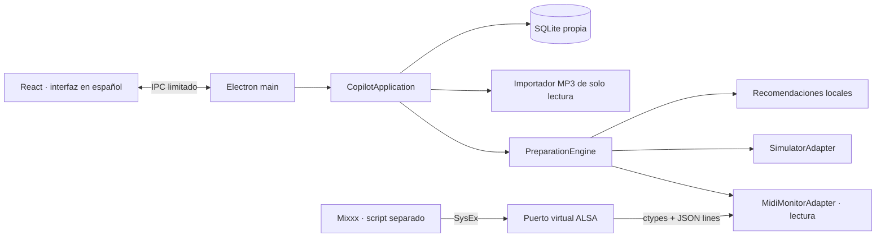

# Arquitectura y decisiones del MVP

## Componentes

El script corre dentro del JavaScript de Mixxx, no en Node. El proceso Python es un adaptador pequeño de las funciones de `libasound`, sin dependencias de pip y sin bindings nativos que recompilar para Electron. El resto del backend y el motor están en JavaScript. El renderer no tiene acceso a Node, al filesystem ni a APIs de Electron abiertas.

## Contrato de adaptador

`snapshot()` entrega modo, conexión, fecha de recepción, capacidades y dos decks. Cada deck contiene identidad opcional, BPM, reproducción, duración, posición, CUE opcional, reserva, dueño y revisión. `prepare(request)` recibe canción, deck fuente/destino, revisiones esperadas, ratio, CUE y callback de cancelación. Los adaptadores emiten `state` y liberan recursos mediante `close()`.

`capabilities.loadByPath=false` impide habilitar automático y ejecutar preparación en el monitor MIDI. Este bloqueo existe en UI, motor y adaptador. No se confunde puerto creado con conexión a Mixxx: se exige telemetría completa y reciente.

## Preparación y exclusión mutua

1. El estado debe ser reciente y el adaptador debe permitir carga por archivo.
2. Debe reproducir exactamente un deck. Dos decks reproduciendo significan transición en curso; cero decks no ofrecen referencia inequívoca.
3. El destino debe estar detenido y sin reserva. Una canción cargada manualmente no se sobrescribe aunque el usuario quite el candado.
4. Solo se reutiliza un deck ocupado cuando el tema fue preparado por el copiloto y ya se registró su reproducción en esta sesión. Un tema preparado pero aún no reproducido permanece protegido.
5. Se toma la primera canción pendiente en el orden de la playlist, excluyendo temas reproducidos, cargados y saltados. El MVP no da una puntuación de compatibilidad inventada.
6. Se exige CUE guardado en modo seguro. BPM desconocido o fuera de rango conserva el tempo original y se comunica.
7. Un mutex evita cargas concurrentes. La operación conserva las revisiones de **ambos** decks.
8. Antes de confirmar, el adaptador vuelve a verificar reproducción, reserva, revisiones y generación de cancelación. El simulador aplica la preparación atómicamente y deja el tema pausado.
9. Cualquier fallo libera el mutex, registra el evento y permite reintentar. Apagar automático o cambiar configuración invalida operaciones pendientes.

Las actualizaciones periódicas de posición no incrementan la revisión del simulador; play/pause, carga, reserva y vaciado sí. Así no se confunden el avance normal de una canción con una intervención del DJ.

## Persistencia

Una base propia con tablas `tracks`, `playlists`, `playlist_tracks`, `history`, `settings`, `events`. Las listas se reemplazan dentro de una transacción; IDs de pistas y hashes evitan duplicados. El historial guarda el modo para distinguir simulación. El monitor v1 no sabe qué canción real se está reproduciendo, por lo que no inventa registros.

La sesión y preferencias persisten. Al reiniciar se vuelve a simulación con decks vacíos y automático apagado. Las demo se agregan solo al pulsar el botón correspondiente y tienen `is_demo=1`. La misma importación se puede repetir sin duplicar filas. Las credenciales de IA no existen todavía.

## Riesgos y límites conocidos

- **Falta de carga e identidad:** es el bloqueo principal para automatización real. Se mantiene el modo real de lectura hasta resolver ambos con una interfaz verificable.
- **Intención manual desconocida:** «pausado» no prueba que esté libre. El simulador usa reservas y propiedad; el monitor no escribe.
- **Frescura y desconexión:** estado MIDI caduca a los dos segundos; los datos antiguos pueden quedar visibles como última lectura, acompañados por «Sin señal».
- **Entorno ALSA:** contenedores, permisos, sandbox de paquetes de Mixxx y disponibilidad de `/dev/snd/seq` afectan la conexión. No se cambia el sistema automáticamente.
- **Importaciones grandes:** lectura secuencial y hash por streams, sin cargar todo el MP3 en RAM. Límite de 20.000 archivos por importación, sin seguir symlinks. El parsing de metadatos y las consultas SQLite comparten el proceso principal; un worker dedicado y paginación serían mejoras antes de bibliotecas masivas. La UI recibe solo datos de estado durante ticks, no toda la biblioteca.
- **Transiciones:** no hay análisis de transitorios, tonalidad o beatgrid. La recomendación es condicional, nunca garantía de mezcla. No se ejecutan loops o efectos.
- **CUE local:** se basa en dato explícito del usuario o fixture demo; no se sincroniza a la base de Mixxx.
- **Distribución:** ejecución de desarrollo/producción desde el proyecto; instaladores `.deb`/AppImage y firma quedan para una entrega posterior.

## Extensiones futuras

Mantener el proveedor de recomendaciones separado del motor de seguridad. IA optativa deberá tener consentimiento, límites de gasto y fallback local. Voz optativa deberá requerir dispositivo de audio específico. Ver [puntos de extensión](../extensions/README.md).
