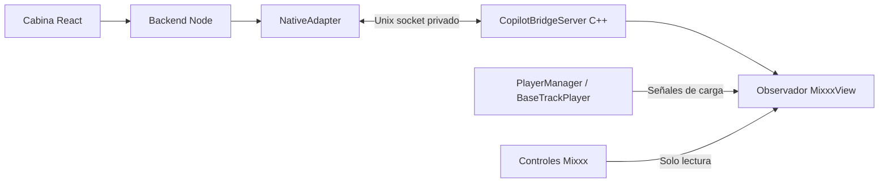

# Puente nativo · prototipo de etapa 3

**La carga automática real NO está implementada ni habilitada.** Esta entrega conecta el backend y la interfaz a un protocolo local real, incluye un servidor C++ probado y un parche de observación para un checkout separado de Mixxx 2.5.6. Permite desarrollar y verificar identidad y comprobaciones previas sin exponer escrituras sobre reproducción o mezcla. No cumple todavía la Fase B de cargar un MP3, confirmar el resultado y dejarlo preparado.

El usuario confirmó físicamente la etapa 2 con Mixxx 2.5.6, MIDI v2 y DDJ-200. Ese código y sus mapeos se conservan. La nueva variante nativa **no fue ejecutada con Mixxx completo ni con la controladora**. El transporte C++ sí fue compilado y probado contra Node mediante sockets Unix reales; el observador C++ compiló a objeto contra sus headers reales, sin enlazar Mixxx completo. Ver [resultados y procedencia](VALIDACION.md).

## A. Investigación y decisión

Base revisada: tag `2.5.6`, commit `3ebac449e7e5fe2a0186596657696e87ce8b0e56` del repositorio oficial. No se presupone compatibilidad con otro commit.

| Alternativa                               | Evidencia y decisión                                                                                                                                                                                                                                                                                                                                                                                                                                                                                               |
| ----------------------------------------- | ------------------------------------------------------------------------------------------------------------------------------------------------------------------------------------------------------------------------------------------------------------------------------------------------------------------------------------------------------------------------------------------------------------------------------------------------------------------------------------------------------------------ |
| Controller scripting 2.5.6                | La interfaz legacy no ofrece ruta/título ni una carga transaccional por ruta. Se preserva MIDI v2 como alternativa manual. [Investigación anterior](MIXXX.md).                                                                                                                                                                                                                                                                                                                                                     |
| Scripting posterior                       | Las declaraciones de `main` revisadas incorporan `getPlayer` y metadatos. No demuestran una transacción de carga por ruta con cancelación en el motor; no justifican actualizar la instalación estable. [Declaraciones oficiales](https://github.com/mixxxdj/mixxx/blob/main/res/controllers/engine-api.d.ts).                                                                                                                                                                                                     |
| `PlayerManager::slotLoadLocationToPlayer` | Existe una ruta C++ de carga mediante Library. Es asíncrona y no lleva un ID/generación de operación hasta el motor; hay además lógica de clonación por doble carga. [PlayerManager](https://github.com/mixxxdj/mixxx/blob/3ebac449e7e5fe2a0186596657696e87ce8b0e56/src/mixer/playermanager.cpp).                                                                                                                                                                                                                  |
| `BaseTrackPlayerImpl::slotLoadTrack`      | Cambia el candidato antes de terminar la decodificación. `getLoadedTrack()` por sí solo no prueba éxito. La ruta de éxito puede restablecer EQ, ganancia y pitch/tempo según preferencias. [BaseTrackPlayer](https://github.com/mixxxdj/mixxx/blob/3ebac449e7e5fe2a0186596657696e87ce8b0e56/src/mixer/basetrackplayer.cpp).                                                                                                                                                                                        |
| Carga interna de audio                    | El worker notifica carga, cierra la fuente anterior y abre la siguiente. `EngineBuffer::slotTrackLoading()` escribe `play` desde el worker. Comprobar pausa en el hilo de UI y luego llamar a cargar deja una carrera con PLAY del usuario. [Worker](https://github.com/mixxxdj/mixxx/blob/3ebac449e7e5fe2a0186596657696e87ce8b0e56/src/engine/cachingreader/cachingreaderworker.cpp), [EngineBuffer](https://github.com/mixxxdj/mixxx/blob/3ebac449e7e5fe2a0186596657696e87ce8b0e56/src/engine/enginebuffer.cpp). |
| Cargas superpuestas                       | El código advierte inconsistencias entre la pista cargada y etiquetas cuando se solicita otra carga durante la anterior. [CachingReader](https://github.com/mixxxdj/mixxx/blob/3ebac449e7e5fe2a0186596657696e87ce8b0e56/src/engine/cachingreader/cachingreader.cpp).                                                                                                                                                                                                                                               |
| Parche dentro de Mixxx                    | Elegido para observación y comprobación local. No se encontró una extensión oficial suficiente en las interfaces investigadas. Mantiene un diff pequeño, sin API de escritura, y requiere compilar una variante separada.                                                                                                                                                                                                                                                                                          |

Enviar `bPlay=false` no resuelve la seguridad: puede detener un deck que empezó a reproducirse después de la comprobación. Cancelar desde Node después de llamar a cargar tampoco revierte el cierre de la fuente anterior. Por eso no se habilitó un envoltorio inseguro de estas funciones.

## B–D. Implementación y límites



- `native/bridge_server.*`: autenticación, sesiones, revisiones, autorización temporal y comprobación de ruta. No enlaza con controles de audio.
- `native/mixxx/copilot_bridge.*`: escucha `loadingTrack`, `newTrackLoaded`, `playerEmpty` y cambios de cantidad de decks. Lee los controles de los dos primeros decks. No llama a `set`, `loadTrack`, play, stop ni APIs de mezcla.
- `scripts/native-prepare.mjs`: agrega esos cuatro archivos y dos entradas CMake; inserta el arranque optativo al final del constructor de PlayerManager. Exige checkout limpio y commit exacto. No edita `/usr`, el perfil habitual, SQLite de Mixxx ni el mapeo Pioneer.
- `adapters/native/`: cliente Node con validación, timeout y descarte de solicitudes. El renderer solo selecciona UUID de biblioteca; no recibe el token ni envía rutas arbitrarias.
- UI: tercer modo **Mixxx nativo · prototipo**, identidad/procedencia, ruta, métricas, permiso para comprobar un deck y cancelación. Automático y Preparar siguiente quedan deshabilitados. Una comprobación correcta nunca muestra «Preparado».

La identidad se confirma solo después de `newTrackLoaded`, si coincide el objeto de pista actual, `track_loaded` está activo y no hay otra carga en curso. Ante cargas superpuestas se retiene identidad desconocida hasta expulsar y cargar nuevamente. Si el observador se conecta después de una carga sin haber visto su éxito, no adivina la identidad. Estos callbacks necesitan validación física en la variante modificada.

Para vincular esa ruta con la playlist, Node busca la ruta exacta importada y comprueba nuevamente SHA-256. Si el archivo cambió o falta, no se registra reproducción ni se infiere coincidencia por título/BPM/duración. Ese hash relaciona la biblioteca local; no prueba los bytes del decoder abierto en Mixxx. Una pista nativa identificada pero no importada puede mostrar título/ruta, sin UUID de biblioteca ni historial automático. La simulación, MIDI manual y origen nativo quedan diferenciados; MIDI/nativo comparten el conjunto de canciones reales reproducidas para evitar repetición al cambiar de modo.

La revisión incluye cargas, reproducción, tempo, CUE, SYNC, scratch y cambios observados de posición estando pausado. El avance normal del deck activo no invalida el permiso. Es un muestreo para comprobación: **no garantiza detectar cada movimiento breve del controlador ni autoriza una carga posterior**.

### Protocolo y límites locales

Linux, socket de archivos `bridge.sock`, sin TCP ni puerto público. Directorio canónico del usuario `0700`, socket sin permisos de grupo/otros, token aleatorio de 256 bits en archivo `0600`, creación exclusiva sin seguir symlinks. Se verifica UID con `SO_PEERCRED`. Un solo cliente autenticado, sesión nueva por conexión. No protege frente a root o un proceso malicioso del mismo usuario con acceso al token; la cadena de build local debe ser confiable.

NDJSON, máximo 64 KiB por mensaje, límites de buffer y solicitudes. Hello exige protocolo `1`, build `copilot-2.5.6-observer-1`, proveedor `mixxx-2.5.6`. El proveedor `fixture-only` es rechazado por la aplicación; únicamente los tests activan el permiso interno para él.

Cada petición lleva `id` único, `session`, `command`, `payload`. Hay respuesta `reply` con `ok`, `code`, `message`, `value`; no se registran credenciales. El servidor rechaza IDs repetidos y cierra al alcanzar el límite de 4096 operaciones por sesión; los pings no consumen ese registro. Estado cada 250 ms con secuencia y fecha; cliente rechaza datos antiguos, futuros, regresivos o de otra sesión. Sin estado durante 2 s se desconecta; autenticación/primer estado y peticiones tienen timeout de 2,5 s; el servidor cierra clientes sin peticiones durante 3 s.

| Comando                           | Resultado                                                                                                                                                                                                                                                                                                                             |
| --------------------------------- | ------------------------------------------------------------------------------------------------------------------------------------------------------------------------------------------------------------------------------------------------------------------------------------------------------------------------------------- |
| `ping`                            | ACK `PONG`.                                                                                                                                                                                                                                                                                                                           |
| `authorize`                       | Ambos decks disponibles y revisiones vigentes; destino detenido, sin carga en curso. Ocupado requiere `replace:true`, expresado en el botón de UI. Permiso de **comprobación** por 10 s; no se libera el deck para automatizar.                                                                                                       |
| `inspect`                         | Consume permiso incluso si falla. Exige exactamente el otro deck reproduciendo, revisiones de ambos, MP3 existente/legible y ruta canónica dentro de la carpeta musical elegida. Rechaza symlinks y rutas externas. ACK `PREFLIGHT_ONLY`, siempre `loaded:false`, `prepared:false`. No decodifica ni certifica que el MP3 sea válido. |
| `cancel`, `reserve`               | Revocan el permiso. No modifican Mixxx.                                                                                                                                                                                                                                                                                               |
| `load`, `prepare`, `tempo`, `cue` | Error `ATOMIC_LOAD_UNAVAILABLE`, siempre.                                                                                                                                                                                                                                                                                             |
| Cualquier otro                    | Rechazado. No hay comandos de shell, play, stop, Auto DJ, EQ, efectos o faders.                                                                                                                                                                                                                                                       |

Cambiar estado/revisión, cancelar, cambiar de modo, perder conexión o vencer el permiso lo revoca. Una solicitud pendiente al cancelar fuerza cierre. No hay reconexión ni reintento automático: **Reconectar** crea una sesión nueva y exige otra autorización. Un ACK tardío no restaura una operación ni identidad.

La comprobación de rutas es de solo lectura, no una reserva de archivo: un cambio posterior del filesystem la invalida como evidencia para cargar. Un futuro cargador debe retener/verificar el archivo durante la transacción. El observador y las comprobaciones de filesystem corren en el hilo de UI; no se midieron latencias con discos lentos/bibliotecas masivas. No es una variante lista para actuaciones en vivo.

## Ubuntu: ejecutar el transporte verificable

La aplicación y MIDI no necesitan Qt de desarrollo. Para el test C++ independiente en Ubuntu amd64 se necesitan `g++`, `qt6-base-dev`, bibliotecas Qt6 Core/Network y Node 24+. Instalarlos requiere la administración normal del sistema; no se instalaron paquetes del sistema durante esta entrega.

```bash
npm ci
npm test
npm run test:native
npm run build
npm run test:desktop
```

`test:native` compila el servidor real y lo conecta por socket a Node con estados artificiales de dos decks. Los archivos de ruta de esos tests son fixtures, no MP3 decodificados. No abre Mixxx, ALSA ni audio. Para headers extraídos en otra carpeta se admite `DJ_COPILOT_QT_HEADERS=/ruta/qt6 npm run test:native`. También hay un CMake independiente en `native/` para el ejecutable fixture; **no compila Mixxx**.

## Ubuntu: preparar la variante aislada de Mixxx

Procedimiento de desarrollo pendiente de ejecutar de extremo a extremo. Requiere compilar Mixxx completo con C++20 y Qt6, además de sus dependencias de audio. Usá preferentemente una máquina de desarrollo o entorno separado para la compilación. Revisá la [guía oficial](https://github.com/mixxxdj/mixxx/wiki/Compiling-on-Linux) y el [script de dependencias del commit](https://github.com/mixxxdj/mixxx/blob/3ebac449e7e5fe2a0186596657696e87ce8b0e56/tools/debian_buildenv.sh) antes de instalar dependencias. En Ubuntu 24.04 el paquete Core5Compat se llama `qt6-5compat-dev`; el nombre `libqt6core5compat6-dev` de ese script no está disponible. Ese script instala muchos paquetes con sudo; no es necesario ejecutarlo para usar la app/MIDI existente.

Desde la carpeta de DJ Copilot:

```bash
mkdir -p "$HOME/src"
git clone --branch 2.5.6 --depth 1 https://github.com/mixxxdj/mixxx.git "$HOME/src/mixxx-copilot-2.5.6"
node scripts/native-prepare.mjs "$HOME/src/mixxx-copilot-2.5.6"
git -C "$HOME/src/mixxx-copilot-2.5.6" diff --check
git -C "$HOME/src/mixxx-copilot-2.5.6" diff
cmake -S "$HOME/src/mixxx-copilot-2.5.6" -B "$HOME/src/mixxx-copilot-2.5.6/build-copilot" -DCMAKE_BUILD_TYPE=RelWithDebInfo -DQT6=ON
cmake --build "$HOME/src/mixxx-copilot-2.5.6/build-copilot" --parallel 2
```

No ejecutar `sudo make install` ni sustituir `/usr/bin/mixxx`. El parche rechaza una segunda aplicación o un checkout con cambios; conservá ese checkout para revisar el diff. La compilación del observador a objeto usó los headers reales, C++20 y `keys.pb.h` generado con Protobuf 3.21; no fue un build/link completo de Mixxx.

Cerrá Mixxx estable manualmente cuando sea seguro y ejecutá, reemplazando la carpeta musical por la que contiene tus MP3:

```bash
node scripts/native-launch.mjs "$HOME/src/mixxx-copilot-2.5.6/build-copilot/mixxx" \
  "/ruta/a/tus/MP3" "$HOME/src/mixxx-copilot-2.5.6/res"
```

El lanzador rechaza otro proceso `mixxx` detectado, crea una sesión IPC nueva y usa `--settings-path` para `~/.local/share/dj-copilot/mixxx-2.5.6-prototype`. No copia el perfil ni la base del Mixxx estable. Usa `--resource-path` del checkout. La variante debe imprimir `DJ Copilot IPC: observation/preflight only; automatic loading DISABLED.`; si falla, revisar el mensaje y no reutilizar tokens/directorios viejos.

En otra terminal del proyecto, después de `npm run build`, ejecutá **el comando exacto impreso por el lanzador**:

```bash
DJ_COPILOT_NATIVE_DIR=/tmp/dj-native-XXXXXX npm start
```

`XXXXXX` es un ejemplo: usá el directorio recién creado. Elegí **Conexión → Mixxx nativo · prototipo**. Una instalación estable sin el parche no puede conectarse. No cambiar permisos a `777`, imprimir el token ni abrir puertos de red para resolver un error.

## E. Prueba física pendiente con DDJ-200

Esta es una prueba de observación/comprobación, **no el escenario de carga automática solicitado**. Usá la variante en una sesión de laboratorio; configurá audio y el preset habitual de Pioneer dentro de su perfil nuevo, sin editar ni reemplazar el perfil/mapeo estable.

1. Importá en Copilot los tres MP3 reales y armá su playlist. Importalos también mediante la interfaz de la variante Mixxx. No usar las filas DEMO.
2. Cargá manualmente El Original en Deck 1 después del arranque del puente. Verificá título/artista, ruta exacta, BPM, CUE, posición y procedencia confirmada. Un archivo no importado debe mostrar ruta nativa pero no vínculo con la biblioteca.
3. Reproducí desde DDJ-200. Probá PLAY/PAUSE, CUE, SYNC, jogs, faders, crossfader, EQ y hot CUE. Copilot no debe enviar ninguna acción. Compará comportamiento y audio con la instalación estable. La observación por sí sola no demuestra ausencia de glitches: registrar resultados.
4. Autorizá la **comprobación** del Deck 2, detenido, y pulsá **Comprobar archivo y deck** para Orgullosa. Debe informar que no cargó ni preparó ninguna canción. No debe cambiar nada en Mixxx. Si está ocupado, el botón exige explícitamente permiso de comprobación de deck ocupado.
5. Repetí sin autorización, con ambos decks reproduciendo, después de cambiar CUE/tempo/pausa, tras esperar más de 10 s y después de cancelar. Debe rechazarse o revocarse el permiso. Una intervención muy breve entre muestras puede no detectarse; no hay escrituras aunque eso ocurra.
6. Cargá otro archivo y expulsá manualmente. La identidad anterior debe desaparecer. Probá recargas del mismo archivo y cargas superpuestas: ante ambigüedad, identidad desconocida hasta expulsar y cargar sin solapamiento.
7. Cerrá Copilot: el audio de Mixxx debe continuar según el control del DJ. Abrilo de nuevo, seleccioná nativo y comprobá que no retorna ningún permiso. Probá cierre del puente en una sesión de prueba y verificá pérdida de identidad/bloqueo; reiniciá con directorio nuevo.
8. Cargá Orgullosa y luego 18 Kilates **manualmente** para verificar recorrido, identidad e historial sin duplicados. Automático permanece apagado. No afirmar que este recorrido valida preparación real.

Antes de una entrega con carga serán obligatorios, además, los dos ciclos automáticos solicitados y fallos de archivo inexistente/corrupto, BPM incompatible, CUE inválido, duplicados, intervención en cada fase y pérdida de conexión antes/durante el commit. Los tests actuales de estos conceptos en el simulador no prueban esas carreras en audio real.

## Qué falta para habilitar carga

1. Propagar ID/generación y cancelación desde UI, biblioteca y worker hasta el motor; invalidarlos por toda intervención relevante del usuario. No bloquear ni interceptar su controladora.
2. Abrir/validar el candidato sin cerrar ni alterar la fuente actual. Preparar recursos fuera del callback de audio.
3. Implementar un commit condicional dentro de la sincronización del motor: comprobar ambos decks, permiso, identidad esperada y pausa antes de intercambiar fuente; conflicto o cancelación conserva la fuente anterior. No resolver la carrera escribiendo stop/play.
4. Separar esa ruta de los resets de EQ/ganancia/pitch, clonación, SYNC y demás efectos de una carga normal. No cambiar globalmente las preferencias del DJ para disimularlos.
5. Confirmar desde el motor qué archivo/generación quedó instalado, detenido, sin confiar solamente en el candidato de UI. Error/cancelación no pueden producir una carga tardía al reconectar.
6. Agregar tempo limitado y CUE verificado como operaciones condicionales posteriores; rechazar SYNC/cualquier estado que pueda propagar tempo al deck activo. Solo entonces habilitar capacidades y el motor de playlist existente.
7. Compilar/linkear Mixxx completo, probar sus hilos con casos adversos y ejecutar la validación física de los tres temas/DDJ-200. Hasta obtener esa evidencia, `loadByPath`, `tempo` y `cue` permanecen `false` en servidor y cliente.

## Volver a la instalación estable

Cerrá manualmente la variante cuando sea seguro. Abrí Mixxx desde el lanzador habitual o `/usr/bin/mixxx`, sin `--settings-path` ni las variables `DJ_COPILOT_NATIVE_DIR`/`DJ_COPILOT_MUSIC_ROOT`. Su perfil y binario originales permanecen intactos. Abrí Copilot normalmente y elegí MIDI v2; si el puerto virtual cambió, reactivá el preset del puerto como en [MIXXX.md](MIXXX.md). No se requiere revertir música, SQLite de Mixxx ni configuración Pioneer.

El checkout y el perfil experimental se pueden conservar para diagnóstico. No se eliminan automáticamente perfiles, credenciales ajenas ni sockets de sesiones anteriores.
